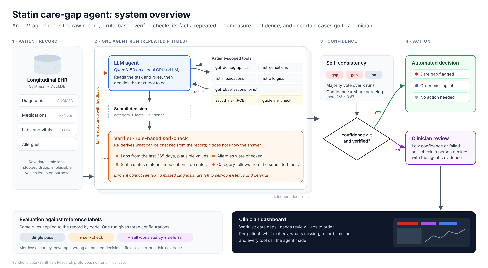
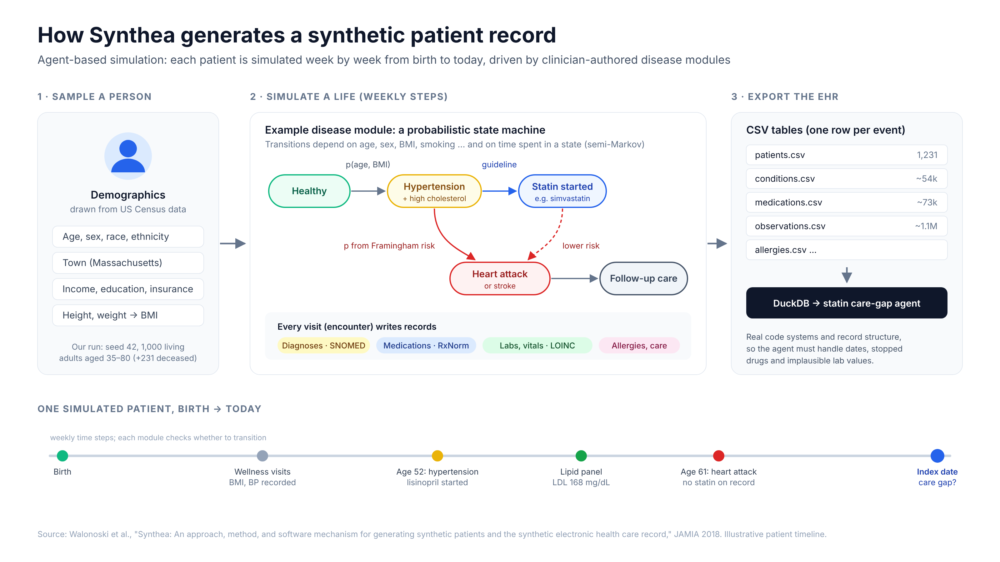

# Statin Care-Gap Agent

An LLM agent that reads a patient's longitudinal health record and decides whether
the patient has a **statin care gap**: a statin is recommended by the guidelines, but
the patient is not taking one. The agent's facts are checked by code, it runs several
times to measure its own uncertainty, and it **hands uncertain cases to a clinician**
instead of guessing. A second agent **interviews the patient** to recover information
the record is missing.

The model is open-weight (Qwen3-8B) and served locally, so records never leave the machine.

> **Research prototype on synthetic data (Synthea). Not for clinical use.**
> The guideline logic is a simplified version of the 2013 ACC/AHA Pooled Cohort
> Equations, the 2018 AHA/ACC cholesterol guideline and the 2022 USPSTF statin
> recommendation.

**Contents:** [Results at a glance](#results-at-a-glance) ·
[The task](#the-task) · [How the system works](#how-the-system-works) ·
[Patient interviews](#extension-patient-interviews) · [Detailed results](#detailed-results) ·
[What we learned](#what-we-learned) · [Quick start](#quick-start) ·
[Code map](#code-map) · [Limitations](#limitations) · [Next steps](#next-steps)

---

## Results at a glance

All numbers are from real runs of Qwen3-8B (k = 3 runs per patient, deferral threshold τ = 0.8).

| | Single pass | Full system |
|---|---|---|
| Wrong automated decisions, 300 random patients | 75 | **0** |
| Precision of care-gap alerts | 0.56 | **1.00** |
| Patients decided automatically | 100% | 78% (the rest go to a clinician) |

| Patient interviews, 50 simulated patients | Record only | After interview |
|---|---|---|
| Correct guideline category | 20% | **92%** |
| Care gaps hidden in the record and found | — | **15 / 15** |
| Correct decisions changed to wrong | — | **0** |

---

## The task

**Users:** primary-care and population-health teams who review panels of patients.

**Input:** one patient's record on an index date (diagnoses, medications with start and
stop dates, allergies, labs, vitals, smoking status), coded with SNOMED CT, RxNorm and LOINC.

**Output:** one of six categories, with the facts and evidence behind it.

| Category | Meaning |
|---|---|
| `indicated` | **Care gap**: statin recommended, none active |
| `on_statin` | A statin is active |
| `contraindicated` | Documented statin intolerance |
| `consider` | Borderline (10-year risk 7.5–10%) |
| `not_indicated` | No statin recommended |
| `insufficient_data` | Needed labs are missing from the last 365 days |

The hard part is reading the record correctly, not applying the rules. The agent must:

- use only labs from the last 365 days and discard implausible values;
- treat a drug as active only if its most recent stop date is empty or after the index date;
- count any myocardial infarction, ischemic heart disease, bypass grafting or stroke as ASCVD;
- count diabetic complications as diabetes, but not prediabetes.

These time-dependent judgments are exactly where language models make mistakes.

---

## How the system works



### Division of labor

The design principle is to let the LLM do what only it can do, and to give everything
else to deterministic code.

| Step | Done by | Where |
|---|---|---|
| Decide which records to look at and extract 14 facts | **LLM** | `agent/backends.py` |
| Access the record | Tools (the LLM never sees the raw database) | `tools.py` |
| 10-year risk (Pooled Cohort Equations) and guideline category | Code, called as a tool | `guideline.py` |
| Check the extracted facts against the record | Code | `agent/verifier.py` |
| Retry, repeated runs, voting, deferral | Code | `agent/pipeline.py` |

### 1. Agent loop (`agent/backends.py`, `tools.py`)

The LLM receives a patient ID and eight tools:

| Tool | Returns |
|---|---|
| `get_demographics` | Age, sex, race, index date |
| `list_conditions` | Diagnoses with onset and resolved dates |
| `list_medications` | Medications with first start, most recent start and stop dates |
| `list_allergies` | Allergies and intolerances |
| `get_observations` | Labs and vitals by LOINC code, each with `days_before_index` |
| `compute_ascvd_risk` | 10-year ASCVD risk |
| `check_statin_guideline` | Guideline category for a set of facts |
| `submit_decision` | Ends the episode: category, 14 facts, rationale, evidence |

The loop calls the model, runs every tool it requests, returns the results, and stops
when the model calls `submit_decision` (or after 16 steps). Every tool call is saved as a
trace, which is what the verifier checks and what the dashboard replays. The same loop
works with any OpenAI-compatible server (vLLM, Ollama), OpenAI, or Anthropic.

### 2. Verifier (`agent/verifier.py`)

A rule-based check that re-derives from the record whatever can be checked mechanically:

1. **A valid decision was submitted** (not a step-limit failure or an invented category).
2. **Lab values.** For LDL, total cholesterol, HDL and systolic BP, the submitted value must
   match the most recent plausible value within 365 days (or be empty if there is none).
   This catches stale values, missed values and invented "typical" numbers.
3. **Statin status** must agree with medication stop dates.
4. **Allergies were checked** (a process check: intolerance cannot be ruled out otherwise).
5. **The category follows from the submitted facts** under the guideline rules.

Each problem is returned as a specific sentence, for example:

> `ldl=61.8, but the most recent plausible LDL within 365 days is None. Re-check dates (365-day window) and discard implausible values.`

The verifier is **deliberately narrower than the reference labels**. It does not check
diagnoses, smoking status or blood-pressure medication, because it should not know the
answer, only what can be checked against the record. Errors it cannot see are left to the
next two layers.

### 3. Retry, self-consistency and deferral (`agent/pipeline.py`)

```text
for each of k = 3 independent runs:
    run the agent  ->  verify
    if problems:   run again with the problems as feedback  ->  verify again   (one retry only)
majority vote over the 3 final answers;  confidence = share of runs that agree
automate only if confidence >= 0.8 and every run behind the majority passed the verifier
otherwise: send to a clinician
```

With k = 3 and τ = 0.8, a decision is automated only when all three runs agree and all
pass the verifier. Each run keeps its first and its final attempt, so a single experiment
yields all three configurations compared below.

### 4. Dashboard (`scripts/06_dashboard.py`)

One HTML page per run: a worklist of care gaps, patients needing review and labs to
order, and for each patient the key facts, what is missing, a record timeline and the
agent's tool calls.

---

## Extension: patient interviews

Records are incomplete and out of date. A second agent (`conversation/interviewer.py`)
interviews a simulated patient to recover what the record is missing, then the guideline
is re-run on the corrected record.

- **The simulated patient** (`conversation/patient.py`) is another LLM that knows the true
  facts and answers only what it is asked.
- **The interviewer** sees only the record and has five tools: `get_record`, `ask_patient`,
  `record_finding` (field, value and **the patient's own words as evidence**),
  `escalate_to_clinician`, and `finish`.
- **Five scenario types** (`conversation/scenarios.py`), 10 patients each:

| Scenario | The record says | The truth |
|---|---|---|
| `stopped_statin` | On a statin | Stopped it months ago |
| `intolerance` | No intolerance | Stopped a statin because of muscle pain |
| `outside_labs` | No recent lipids | Lipid panel at another clinic |
| `now_smoker` | Non-smoker | Currently smokes |
| `control` | Correct | Nothing hidden |

Scoring (`conversation/evaluate.py`): category before and after, hidden care gaps found,
correct decisions changed to wrong, escalations, and whether the quoted evidence actually
supports each recorded value. Details: [docs/conversation_notes.md](docs/conversation_notes.md).

---

## Detailed results

### Record review (Qwen3-8B, k = 3, τ = 0.8)

**Random sample, 300 patients** (`qwen8b_rand300_k3`; class mix as in the cohort, 29 care gaps):

| Configuration | Wrong automated | Accuracy (automated) | Coverage | Deferred | Care-gap precision | Care-gap recall (automated) |
|---|---|---|---|---|---|---|
| Single pass | 75 | 0.750 | 1.000 | 0 | 0.56 | 0.97 |
| + self-check | 2 | 0.992 | 0.887 | 34 | 1.00 | 0.90 |
| + self-consistency + deferral | **0** | **1.000** | 0.780 | 66 | **1.00** | 0.86 |

- A single pass was wrong for one patient in four, and **about 44% of its care-gap alerts
  were false**, mostly patients without recent lipids flagged using stale values.
- With the full system, **none of the 234 automated decisions was wrong**. The 5 final
  answers that differed from the reference were all among the 66 deferred patients. Every
  true care gap was either flagged automatically (25) or sent to review (4).
- The cost is deferral: 61 of the 66 deferred patients were in fact answered correctly.

**Stratified sample, 84 patients** (`qwen8b_strat100_k3`; 20 per class, plus all 4
`consider` patients in the cohort):

| Configuration | Wrong automated | Accuracy (automated) | Coverage | Deferred | Care-gap precision | Care-gap recall (automated) |
|---|---|---|---|---|---|---|
| Single pass | 14 | 0.833 | 1.000 | 0 | 0.74 | 1.00 |
| + self-check | 1 | 0.987 | 0.893 | 9 | 1.00 | 0.90 |
| + self-consistency + deferral | **0** | **1.000** | 0.726 | 23 | **1.00** | 0.90 |

**Field-level extraction error** (random sample, first attempt → after self-check):

| LDL | Total cholesterol | HDL | Systolic BP | Hypertension |
|---|---|---|---|---|
| 25% → 6% | 27% → 4% | 26% → 5% | 12% → 4% | 6% → 7% |

The verifier fixes what it checks (labs) and leaves what it does not check (diagnoses such
as hypertension) unchanged; those errors are caught by voting and deferral.

### Patient interviews (Qwen3-8B as both interviewer and patient)

| Scenario | Correct before | Correct after | Notes |
|---|---|---|---|
| `stopped_statin` | 0% | **100%** | all 10 hidden care gaps found |
| `now_smoker` | 0% | **100%** | |
| `intolerance` | 0% | 80% | escalated 6 of 10 |
| `outside_labs` | 0% | 80% | 21 of 30 lab values recovered |
| `control` | 100% | 100% | nothing changed wrongly |
| **All 50** | **20%** | **92%** | 3.9 questions per patient |

27 of 163 recorded findings were not supported by the quoted evidence (see below).

**Caveats.** Single runs without confidence intervals. The 30 patients used during prompt
development also fall in the formal samples (the same sampling seed), so the results may be
slightly optimistic. Synthetic data and simplified rules throughout.

---

## What we learned

1. **The final category hides extraction errors.** Early on, 9 of 10 categories were correct
   while 30–50% of some lab fields were wrong, because most of those patients were already on
   a statin or lacked recent labs. Field-level scoring is necessary.
2. **The model found a gap in the reference labels.** In 119 Synthea patients, diabetic
   complications (for example "disorder of kidney due to diabetes mellitus") appear without
   a separate diabetes code. The model counted them; the labels did not. After fixing the
   labels and the prompt, the diabetes error fell from 50% to 0%.
3. **Typical failure modes of the 8B model:** skipped lab queries, values older than 365 days,
   prediabetes read as diabetes, and round "typical" values (200 / 40 / 140) that were not in
   the record.
4. **Feedback helps only when the procedure is explicit.** Retrying with the verifier's feedback
   did not fix lab errors until the prompt spelled out the procedure (one query per LOINC code,
   check `days_before_index`, never fill in values). Then the same feedback cut lab errors to about 5%.
5. **Interview failures are about recording, not understanding.**
   - *Understood but not recorded:* the patient reports muscle pain, the agent escalates and
     writes "intolerance" in its summary, but never calls `record_finding`, so the decision
     does not change.
   - *Unsupported evidence:* lab values copied from the record, quoted with the patient saying
     no test was done.

---

## Quick start

### 1. Install and test (no data or GPU needed)

```bash
pip install -r requirements.txt
pytest -q --ignore=tests/test_active.py        # 7 tests on small fixture CSVs
```

### 2. Generate data and reference labels

```bash
bash scripts/01_generate_synthea.sh 1000 42     # needs Java 17+
python scripts/02_build_database.py             # Synthea CSV -> DuckDB
python scripts/03_build_ground_truth.py         # -> results/labels.csv
```

### 3. Serve the model

One A100 is enough for Qwen3-8B. vLLM compiles kernels at start-up and needs `nvcc` from a
CUDA toolkit that matches PyTorch's CUDA version.

```bash
vllm serve Qwen/Qwen3-8B --served-model-name qwen3-8b \
  --enable-auto-tool-choice --tool-call-parser hermes --max-model-len 32768 --port 8000
export OPENAI_API_KEY=EMPTY
```

### 4. Run, evaluate, view

```bash
# record review
python scripts/04_run_agent.py --backend openai --base-url http://localhost:8000/v1 \
  --model qwen3-8b --n 300 --k 3 --workers 16 --run-name qwen8b_rand300_k3
python scripts/05_evaluate.py --run qwen8b_rand300_k3
python scripts/06_dashboard.py --run qwen8b_rand300_k3

# one patient with the full trace printed
python scripts/demo_patient.py --backend openai --base-url http://localhost:8000/v1 --model qwen3-8b

# patient interviews (10 per scenario type)
python scripts/08_interviews.py --base-url http://localhost:8000/v1 --model qwen3-8b --n 10 --workers 8

# data for the interactive results page
python scripts/09_export_showcase.py            # -> results/showcase.json
```

- Add `--stratify` to `04_run_agent.py` to sample about equally from each category.
- Runs resume: re-running with the same `--run-name` skips finished patients.
- Other backends: `--backend anthropic`, or `--backend openai` with a hosted model.
  `--backend simulated` runs a scripted agent with injected errors to test the pipeline
  without a model; its numbers say nothing about LLM accuracy.

---

## Code map

About 1,500 lines of Python. Start with the four files marked ★.

```
src/statin_agent/
  agent/
    pipeline.py      ★ k runs -> verify -> one retry -> vote -> automate or defer
    verifier.py      ★ rule-based check of the submitted facts against the record
    backends.py      ★ agent loop: call the model, run its tool calls, collect the trace
    prompts.py         system prompt (the procedure the agent must follow)
    simulated.py       scripted agent for testing without a model
  tools.py           ★ the eight tools the agent can call
  guideline.py         guideline rules and Pooled Cohort Equations
  facts.py             reference facts and labels (used for evaluation, never by the agent)
  codes.py             SNOMED / RxNorm / LOINC code lists, plausible ranges
  db.py                patient-scoped access to DuckDB
  evaluation.py        accuracy, coverage, care-gap precision/recall, field errors
  conversation/
    scenarios.py       five scenario types built from real cohort patients
    patient.py         simulated patient
    interviewer.py     interviewing agent and its tools
    evaluate.py        interview scoring
  active/              budget-aware review order (experimental, not yet evaluated)
  templates/dashboard.html

scripts/
  01_generate_synthea.sh   02_build_database.py   03_build_ground_truth.py
  04_run_agent.py          05_evaluate.py         06_dashboard.py
  07_active_review.py      08_interviews.py       09_export_showcase.py
  demo_patient.py
configs/default.json       paths, cohort, index date, k, τ, step limit
tests/                     unit and end-to-end tests on small fixture CSVs
docs/                      figures and notes
```

---

## Data



- **Synthea** (MITRE): 1,000 living adults aged 35–80 (seed 42), CSV export with SNOMED CT,
  RxNorm and LOINC codes, loaded into DuckDB.
- **Cohort:** living patients aged 40–80 on the index date (the last date in the data).
- **Reference labels** (`facts.py`, `guideline.py`): the same rules applied to the record by
  code. They measure faithful extraction and procedure under these rules, not clinical correctness.

---

## Limitations

- **Synthetic data.** Synthea records have no free-text notes and few current smokers, and
  statins are rarely stopped. Real records are messier and will produce new error types.
- **Labels follow the same simplified rules** as the guideline tool, so the evaluation measures
  extraction and procedure, not clinical judgment.
- **One model.** Results are for Qwen3-8B; larger models may need less deferral.
- **The simulated patient is an LLM** and is more cooperative and consistent than real patients.
- **About half the cohort lacks lipids from the last year**, so `insufficient_data` is common.

## Next steps

- **Budget-aware review.** Use cost-aware active sampling to decide which patients the agent,
  and then a clinician, should review first under a fixed token and clinician-time budget
  (code in `active/`, not yet evaluated).
- **Training the agent.** Use the verifier as a reward: rejection-sampling fine-tuning first,
  then reinforcement learning, so fewer cases need deferral.
- **Uncertainty decomposition.** Separate model uncertainty (runs disagree) from data uncertainty
  (risk near a threshold, missing labs), which call for different actions.
- **Real records.** De-identified records with free-text notes, and clinician review of deferred cases.

## References

- Goff DC Jr, et al. 2013 ACC/AHA Guideline on the Assessment of Cardiovascular Risk. *Circulation*, 2014.
- Grundy SM, et al. 2018 AHA/ACC Guideline on the Management of Blood Cholesterol. *Circulation*, 2019.
- US Preventive Services Task Force. Statin Use for the Primary Prevention of Cardiovascular Disease in Adults. *JAMA*, 2022.
- Walonoski J, et al. Synthea: an approach, method, and software mechanism for generating synthetic patients and the synthetic electronic health care record. *JAMIA*, 2018.